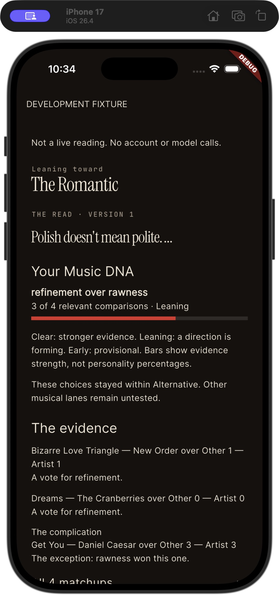
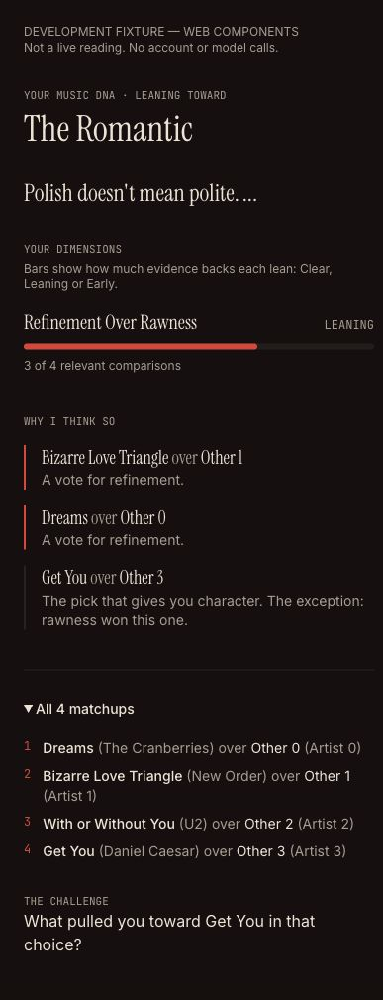
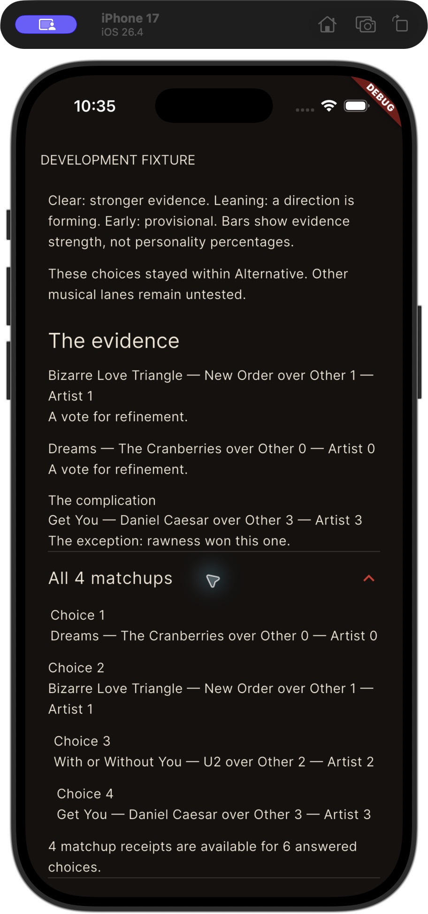
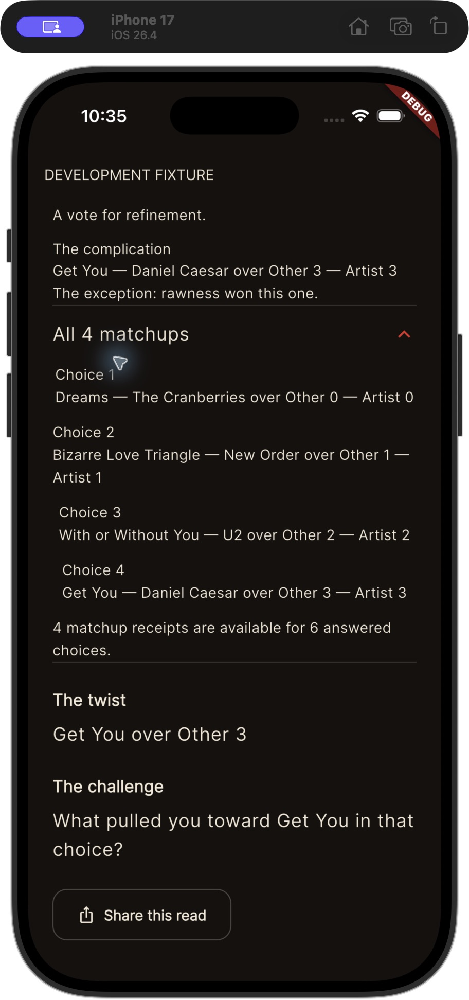

# AB-66 — native saved report parity for 0.1.1 (12)

Code candidate, not a release receipt. Alan merges and separately approves TestFlight uploads. Build 11's public review submission is untouched.

## Behavior

The report now follows identity → saved Sol prose → dimensions → evidence/all matchups → challenge → actions. A named, frozen launch archetype takes precedence over an emerging signature; older readings are never rematched. The six launch names are Anthemist, Atmospherist, Hedonist, Romantic, Transformer and Witness. Deferred/unknown names are not offered as live matches. Profile version is shown when the saved envelope supplies it. Flutter does not calculate profile scores, confirmation thresholds or weights.

Clear/Leaning/Early bar lengths mirror the web's categorical evidence strength, accompanied by actual supporting/relevant counts and an explanation that they are not personality percentages. Two supporting dimensions are preferred when supplied; at most one supplied contradiction is shown. All supplied matchup receipts remain in order. Missing rows are disclosed rather than filled in.

Reopen/restart/recovery uses authenticated `GET /api/v1/session/:id/report`, optionally `?version=N`. A saved report is tried before model-capable matchup/generation calls, including when AI permission is declined or revoked. No saved report generation is triggered by an exact-version miss or an unavailable check. `NO_RESULT`, `VERSION_NOT_FOUND`, `NOT_FOUND` and `UNAVAILABLE` remain distinct. A missing older-server route can fall back to the existing read-only chat/result history; explicit owner/version/availability errors cannot. Optional annotation or history metadata failures do not hide saved prose.

Fresh reveals consume their inline `dna_summary` and signature, preserving the existing request count and avoiding an added final-read wait. Saved reopens additionally display frozen profile-version provenance if supplied by `/report`. They use the same typed report widgets and retain their saved voice/narration metadata.

Archetype fit is a compact optional disclosure below the completed report: Yes / Somewhat / No. It reuses the existing feedback Cubit/repository with `target=archetype:<frozen name>` and exact result version. Reading accuracy keeps `target=null`. Owner changes invalidate pending feedback, widget identities include owner/version/archetype, and a save must read back its matching mutation before claiming success. This does not enroll anyone in learning or grant export consent.

## Contract and visual evidence

Backend report contract/fixtures: `acedge123/music-dna`, report-envelope-v1, reviewed from `128780a66afa35845c9090ff01e74647fb5cfb4b`; weight-versioning readiness subsequently checked at `cf29128d44f899c3d9abd411c3b2404dbbc1e168`. The three JSON files in `test/fixtures/report/` are copied from the committed backend fixtures. Their illustrative `answered=6` payload includes only four matchup rows; the UI accurately labels the four rows and discloses incomplete receipt coverage. They are not Alan's reading.

Native screenshots below are from the separate **MusicDNA Fixture** iPhone 17 Simulator app, using the actual Flutter report components and theme. It has its own local bundle identifier; the physical phone and existing Simulator MusicDNA app were preserved. The web reference renders the source web `DnaIdentity` / `DnaEvidence` components and stylesheet with the same fixture at 402px width. Authenticated controls/Refine are outside that web fixture. These images compare fixture presentation, not signed-in production parity or TestFlight acceptance.

| Native identity / dimensions | Web identity / evidence |
| --- | --- |
|  |  |

| Native supplied matchups | Native challenge / actions |
| --- | --- |
|  |  |

The local debug-only entrypoint `tool/report_preview.dart` accepts a `REPORT_FIXTURE` JSON string through `--dart-define-from-file`. It is not imported by the production entrypoint and refuses release-mode execution. It constructs no API client/account and makes no model calls; normal theme fonts may download as in the app. Production builds must use `lib/main.dart` and their normal configuration, never this fixture entrypoint.

## Validation and remaining acceptance

- `flutter analyze --no-pub`: no issues. `flutter test --no-pub`: 223 passed, one optional live-capture test skipped. Local iOS Simulator debug compile passed.
- Contract/repository tests: immutable text, legacy identity absence, malformed optional metadata, six-name eligibility, exact version/owner identity, explicit failure codes, GET-only legacy fallback, and inline/reopen agreement.
- Cubit/widget tests: restart/mode preservation, interrupted reveal recovery without a second POST, saved-only retry/version isolation, report ordering, four-answer/cumulative counts, incomplete receipts, small phone/large text, separate accuracy/fit targets, readback, and late owner/version acknowledgments.
- AB-70 still needs verified backend deployment and a real signed-in report/fresh-reopen comparison, Alan's saved six-choice reading (including his actual complication), fit-feedback persistence, and TestFlight visual acceptance. No production/model/feedback writes were performed for this PR.
- Q3 pushback UI is AB-67; Refine/library UI is AB-68; production archetype activation and Song Why consumption/coverage are AB-69. This PR does not activate those features or imply approved Whys are in use.
